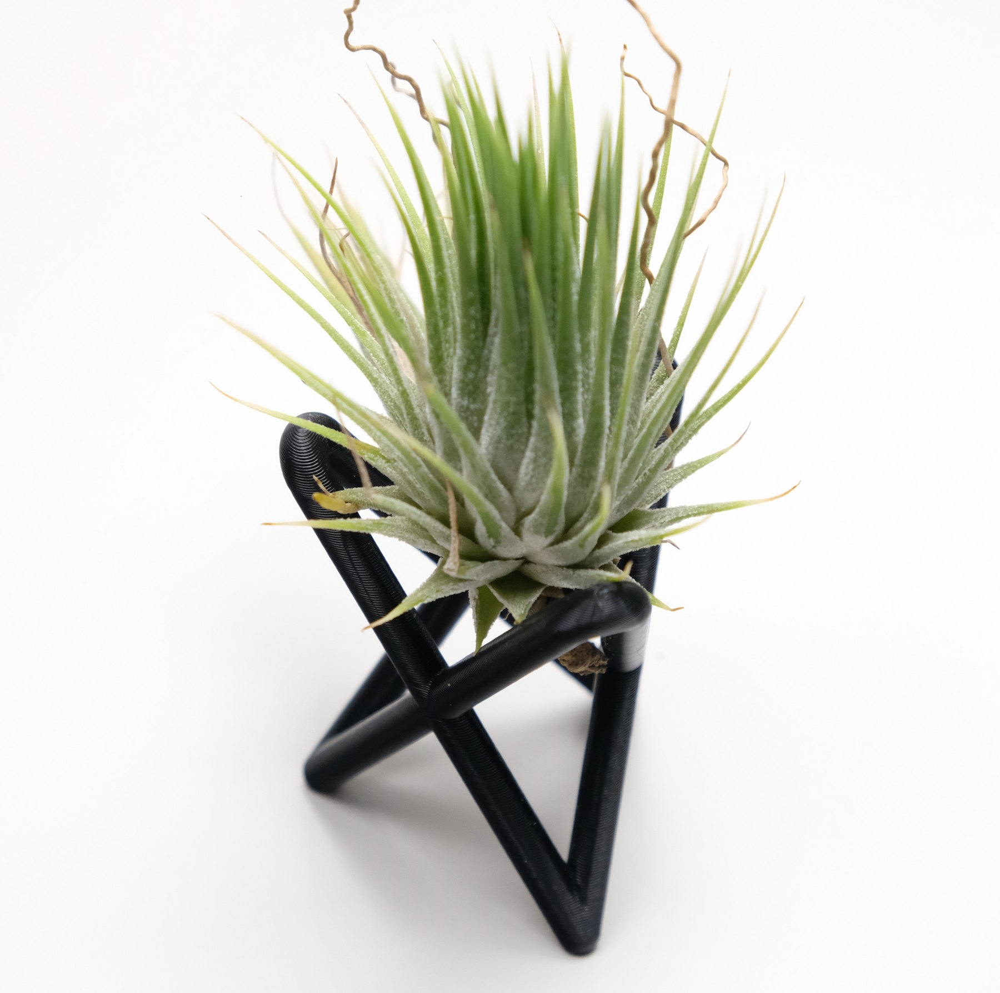
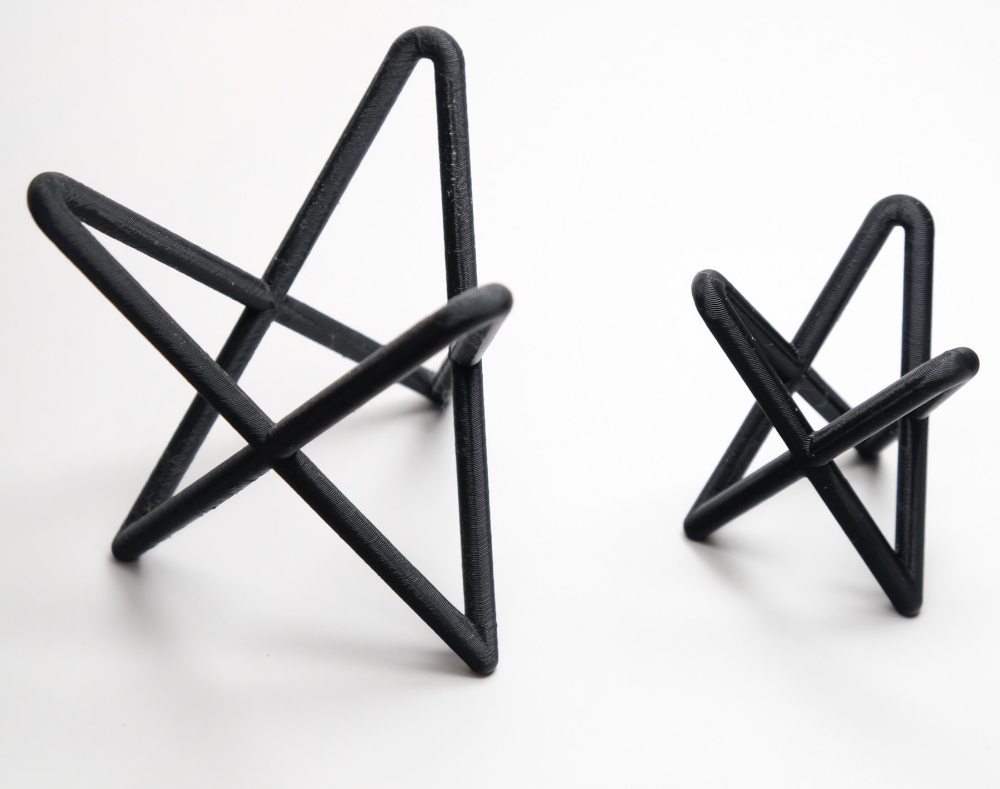
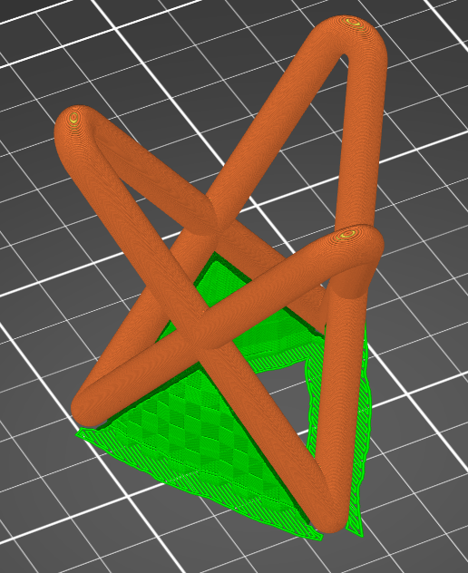
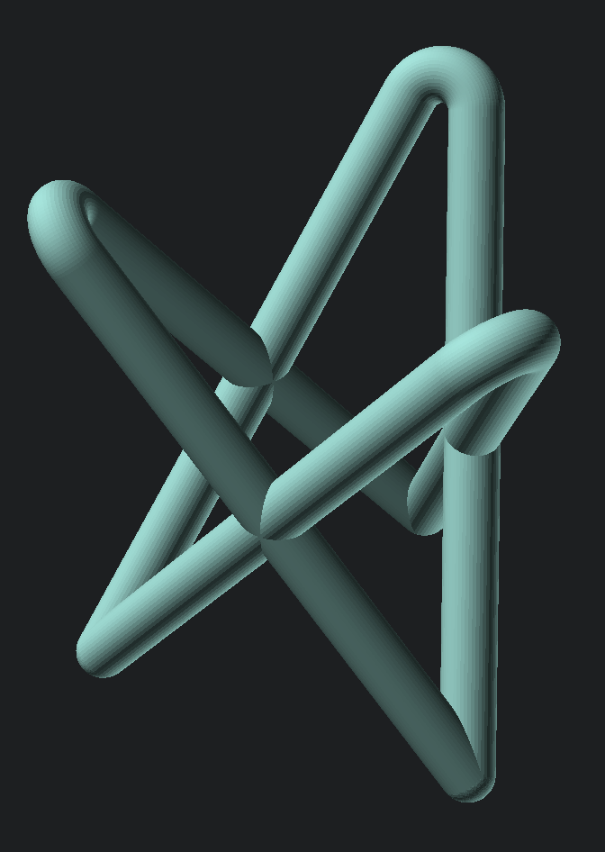

# Tripod Stand

A wireframe tripod stand for displaying small objects like air plants.

I saw a welded wire version of this stand for sale, but I wanted something that I could easily adjust to different sizes and shapes of plant. The model is parametric, and the size, angles, and wire width can all be adjusted independently.

# Printing

This model is designed to be printed on a standard consumer grade FDM printer using any standard filament such as PLA.

While this model doesn't have any true overhangs, supports are required to stabilize the print or it will detach from
the print bed. For the cleanest results, use snug supports and paint the supports on only the bottom of the legs.

# Models in this Project

|Image|Name|File|Description|
|-|-|-|-|
||`tripod_stand`|`tripod stand.scad`|The tripod stand.|

# Dimensions

This design is parametric. The included export script will export the stand in 50mm, 65mm, and 80mm sizes by default.
The size indicates the max width of the legs.

# Project Setup for Local Editing

Everything below this point is only relevant if you want to download this project and make edits.

## Cloning this Repository

This project uses a submodule for common SCAD code. If the submodule is not initialized, the `openscad-utilities`
directory will be empty, and the project won't render.

To get the submodule code when cloning, add the `--recurse-submodules` option to the clone command. For example:
> `git clone [Project URL] --recurse-submodules`

If you've already cloned the project, run this command in the project root to pull down the submodule:
> `git submodule update --init`

## Exporting Model Files

There are two options for exporting the models:

1. Through the provided [SCAD Export](https://github.com/CharlesLenk/scad_export) script.
2. Manually through the [OpenSCAD](https://openscad.org/) UI.

As of 2024, the OpenSCAD development preview uses a new rendering engine called Manifold. Using the development preview
with Manifold will render the models many times faster, regardless of how you export this project.

### 1. Exporting with the Script

The `export.py` script depends on SCAD Export. To set up SCAD Export and run the script, follow the
[SCAD Export quick start guide](https://github.com/CharlesLenk/scad-export/wiki/1.-Usage#quick-start).

### 2. Exporting Manually

The `export map.scad` file contains an `if/else` condition where the call to generate each model can be seen. You can
either write OpenSCAD code using these calls to build up a print plate, or the model "name" can be manually edited to
select each model, which can then be rendered and exported through the OpenSCAD UI like any other project.
